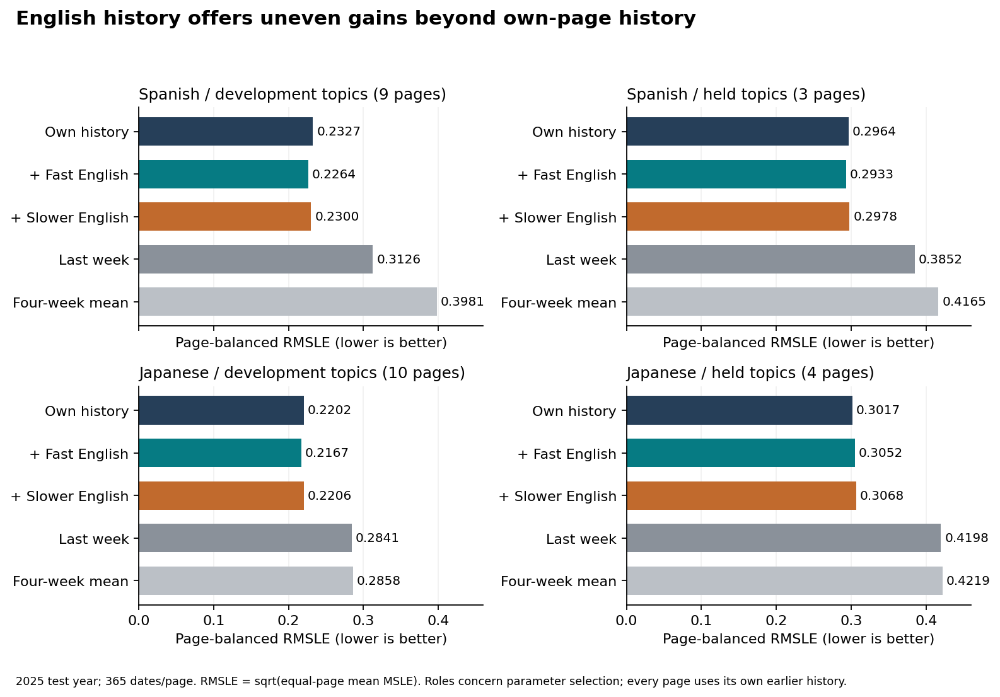

# English history did not improve every topic holdout

Fast English lags lowered 2025 RMSLE from **0.2964 to 0.2933** across three held Spanish topics, but raised it from **0.3017 to 0.3052** across four held Japanese topics. Japanese had not supplied hyperparameter-selection outcomes. Three of its four held pages improved individually; the larger loss on the Tsunami page reversed the equal-page mean. A majority of page-level wins did not establish useful average transfer.

For an editor deciding whether to add another language's history, retain the own-history comparator and examine the target language and held topics separately. The fast-English held-topic month-block intervals cross zero in both languages, so these small-panel point differences do not establish a general gain or loss. Collect historical API publication vintages and a new protected period before making a live-use decision.

| Hyperparameter-selection role | Pages | Own-history RMSLE | Fast-English RMSLE | Slower-English RMSLE |
|---|---:|---:|---:|---:|
| Spanish development topics | 9 | 0.2327 | 0.2264 | 0.2300 |
| Spanish held topics | 3 | 0.2964 | 0.2933 | 0.2978 |
| Japanese development topics | 10 | 0.2202 | 0.2167 | 0.2206 |
| Japanese held topics | 4 | 0.3017 | 0.3052 | 0.3068 |

RMSLE is the square root of the equal-page mean squared error in log(1+views), not a percentage. Each page contributes 365 dates. The test year is held for every row; the roles distinguish which topics/language supplied earlier hyperparameter selection. Each final page model uses its own pre-2025 history, so this is parameter-selection transfer rather than cold-start prediction.

**Current state: local scientific and publication checks pass; exact-head Linux CI and release remain pending.** Three reviewed figures, the [six-page manuscript](paper/README.md) and a fresh replay accompany the result. The revised sixteen-topic snapshot retains 289 response records and 69,300 daily count rows. Independent SQL/source checks reconcile every count, 48 title identities and all 32 candidate pair-date manifests. Twenty-six Spanish/Japanese pairs pass the unchanged coverage minimums; six pair exclusions remain explicit.

The complete finite search retains 567 forward fits and all 69,174 validation predictions. Each fit and all 78 final refits pass an independent objective/gradient/Hessian and augmented-QR coefficient check; the largest independent gradient across both stages is 2.58e-14. Selected penalties are 0.001 for own history, 0.01 with fast English lags and 0.001 with slower English lags. The original smaller grid and [bounded validation-only extension](SEARCH_EXTENSION_V2.md) remain visible. These are finite-grid choices, not global generalization optima. All three families and both simple baselines are reported.

The [final models and transforms](results/frozen_models.json) were committed at `5a446198de1f0fc3eff16b675f39cd37a60236df` before first test inference. Independent scalar reconstruction checks every one of the 47,450 final predictions, 130 page/method metric rows, 30 summaries and 16,000 paired common-month draws at 1e-7 absolute/1e-9 relative tolerance. [All eight paired intervals](results/paired_intervals.csv) remain available; they condition on twelve observed months and a fixed convenience panel.

Raw error measures can disagree with log-scale error. On Japanese held topics, the fast-English system reduced equal-page MAE from 65.66 to 64.28 views/day while worsening RMSLE. Full MAE, MSE, RMSE and fitting-period seasonal MASE are retained in [the metric table](results/test_metrics.csv). No staffing cost, attention allocation outcome or business saving was measured.

The original twelve-topic snapshot and its failed gate are retained in [the source amendment evidence](results/corrections/source-v1-coverage-hold.json). [The pre-fit amendment](SOURCE_AMENDMENT_V2.md) corrects the title-move date interval and adds four development topics without changing model grids, metrics, time boundaries, holdouts or coverage minima.

The comparison uses current historical data, not historical API release vintages. A two-day input lag is a declared availability assumption. Results therefore describe a retrospective benchmark and cannot establish real-time forecast performance, reader geography, language fluency or a causal direction of attention.

See [the fixed protocol](PROTOCOL.md) and [source and method context](SOURCES.md). All candidate trials, predictions, numerical fitting certificates, independent checks and limitations are retained. The independent manuscript accompanies this GitHub package; formal-publication projects are outside this study.

## Inspect and reproduce



The three [PDF/PNG figures](figures) show every method, all paired intervals, the complete finite search and held-month sensitivity. Their [numeric bindings](results/figure_values.json) are independently checked. [The source-to-manuscript check](results/INDEPENDENT_PAPER_CHECK.json) verifies rounded headline values and the six exclusions.

Use Python 3.10 and the pinned requirements:

```text
pip install -r requirements.txt
python -m unittest discover -s tests -v
python src/check_reproduction.py
python src/verify_paper.py
```

The full replay is offline: it hashes the retained source, independently checks existing results, then rebuilds ingestion, all 567 validation and 78 final fits, predictions, metrics, common-month resampling and figures in a temporary folder. It compares every retained scientific value at absolute 1e-7 / relative 1e-9 tolerance. Within-run hashes remain strict; cross-platform newline serialization, runtime observations and the temporary replay commit marker are excluded from scientific-value comparisons. The original 405-fit archive and historical committed freeze are checked separately.

Independent numerical evidence is in results/INDEPENDENT_SOURCE_CHECK.json, INDEPENDENT_VALIDATION_CHECK.json, INDEPENDENT_FROZEN_CHECK.json, INDEPENDENT_EVALUATION_CHECK.json and INDEPENDENT_PRESENTATION_CHECK.json. The [replay receipt](results/reproduction.json) records the actual scope and runtime. These finite checks do not establish universal correctness or real-time performance.
